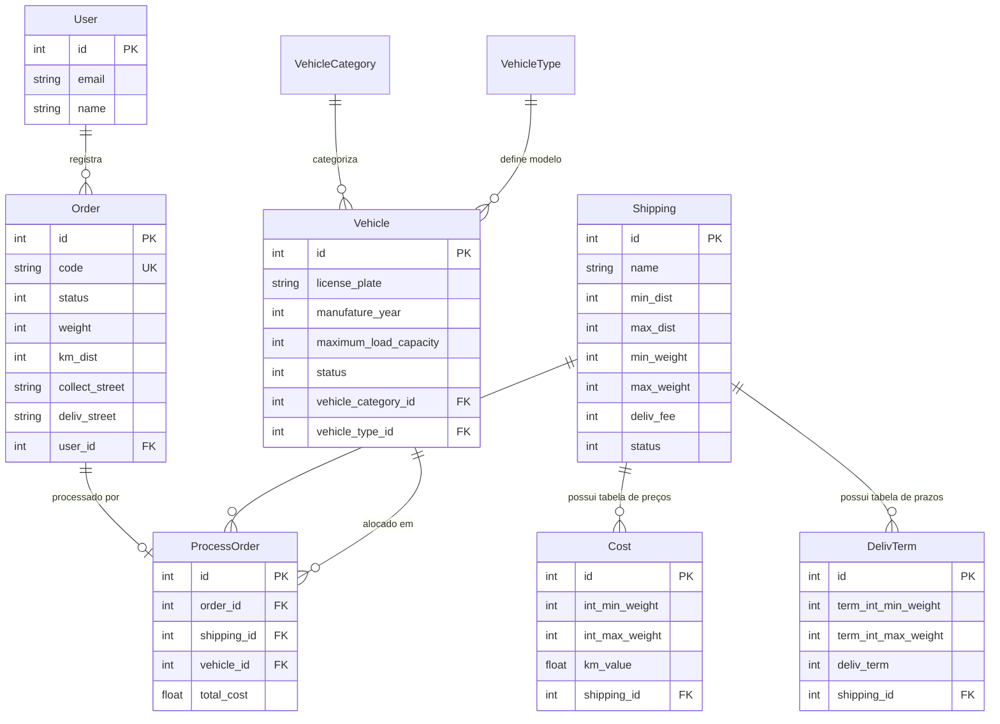

# 🚚 Shipping App - Sistema de Gestão de Fretes e Entregas

> **Nota:** Este projeto é a saída de uma proposição desenvolvida durante o curso **Quero ser dev 40+** da **[Campus Code](https://www.campuscode.com.br/)**.

[](https://www.ruby-lang.org/)
[](https://rubyonrails.org/)
[](https://www.sqlite.org/)
[](https://getbootstrap.com/)
[](https://rspec.info/)
[](#testes-e-cobertura)
[](https://rubocop.org/)

---

## 📖 Sobre o Projeto

O **Shipping App** é uma aplicação web desenvolvida em **Ruby on Rails** voltada para o gerenciamento de serviços de transporte e logística. A plataforma centraliza o controle operacional de entregas, frotas e cotações, permitindo:

- Cadastro e parametrização de modalidades de transporte com limites de alcance e carga.
- Configuração de tabelas dinâmicas de preços por quilômetro rodado e prazos estimados de entrega.
- Gerenciamento completo de veículos (tipos, categorias e capacidade de carga).
- Abertura de ordens de serviço / pedidos com preenchimento automático de endereços via integração com o serviço **ViaCEP**.
- Alocação inteligente de veículos e cálculo automático de custos e prazos para cada entrega.
- Controle do ciclo de vida dos pedidos (pendente, em entrega, entregue ou cancelado).

---

## ⚙️ Funcionalidades Principais

### 🚛 Modalidades de Transporte (`Shipping`)
- Cadastro de novas modalidades informando nome, faixas de distância (mínima/máxima em km), faixas de peso (mínimo/máximo em kg) e taxa fixa de entrega (`deliv_fee`).
- Listagem e busca rápida de modalidades por nome na tela inicial.
- Ativação e desativação de modalidades.
- Edição dos dados cadastrais da modalidade.

### 💰 Tabela de Preços e Prazos (`Cost` & `DelivTerm`)
- **Tabela de Custos por Peso/KM**: Associação de faixas de peso a um valor cobrado por quilômetro rodado (`km_value`).
- **Tabela de Prazos de Entrega**: Associação de faixas de peso a prazos estimados em horas/dias (`deliv_term`).

### 🚗 Gestão de Frotas e Veículos (`Vehicle`, `VehicleType`, `VehicleCategory`)
- **Categorias de Veículos**: Cadastro de categorias estruturadas (ex.: *Sedan médio*, *PickUp grande*, *Furgão*, etc.).
- **Modelos e Fabricantes**: Cadastro de fabricantes e modelos (ex.: GM Prisma, VW Amarok, Fiat Strada).
- **Controle de Frota**: Cadastro de veículos com placa, ano de fabricação, capacidade máxima de carga (kg) e vinculação de tipo/categoria.
- **Controle de Disponibilidade**: Status do veículo gerenciado automaticamente entre *Ativo*, *Desativado* e *Em uso*.

### 📦 Ordens de Serviço e Entregas (`Order` & `ProcessOrder`)
- **Cadastro de Pedidos**: Registro com dados do remetente (coleta) e destinatário (entrega), peso, dimensões (altura, largura, profundidade) e distância em km.
- **Integração com API ViaCEP**: Ao informar o CEP de coleta ou entrega, o sistema busca e preenche automaticamente logradouro, bairro, cidade e UF usando a biblioteca HTTP `Faraday`.
- **Código de Rastreamento Único**: Cada pedido recebe automaticamente um código alfanumérico único de 15 caracteres em caixa alta gerado via `SecureRandom`.
- **Seleção de Modalidade e Alocação de Frota (`ProcessOrder`)**:
  - Filtra as modalidades ativas compatíveis com a distância e o peso da encomenda.
  - Seleciona automaticamente um veículo ativo com capacidade de carga suficiente.
  - Calcula o custo final do transporte (taxa de entrega + custo por km da faixa de peso).
- **Ciclo de Vida do Pedido**:
  - `pending` (Pendente): Pedido cadastrado, aguardando início/seleção da modalidade.
  - `delivering` (Em entrega): Pedido despachado; o veículo vinculado entra em status *em uso*.
  - `delivered` (Entregue): Entrega concluída com sucesso; o veículo é liberado de volta ao status *ativo*.
  - `canceled` (Cancelado): Pedido cancelado antes do início do transporte.

---

## 🔒 Regras de Negócio e Integridade

- **Bloqueio de Edição e Cancelamento**: Uma vez que a ordem de serviço foi iniciada (status `delivering`), ela **não pode mais ser editada nem cancelada** diretamente pelo operador.
- **Imutabilidade Estrutural**: Tipos e categorias de veículos são imutáveis após cadastrados para preservar o histórico operacional.
- **Disponibilidade de Frota**: Um veículo alocado em uma entrega não pode ser selecionado para outro pedido simultâneo até que a entrega atual seja finalizada.

---

## 🗄️ Modelagem de Dados

O diagrama relacional completo do banco de dados está disponível na raiz do repositório no arquivo:  
📁 **[`README_db_schema.png`](README_db_schema.png)**

### Visão Lógica dos Relacionamentos



---

## 🛠️ Tecnologias e Ferramentas

- **Linguagem**: [Ruby 3.1.2](https://www.ruby-lang.org/) (compatível com Ruby 3.2.x)
- **Framework Web**: [Ruby on Rails 7.0.4](https://rubyonrails.org/)
- **Banco de Dados**: [SQLite3](https://www.sqlite.org/)
- **Autenticação**: [Devise](https://github.com/heartcombo/devise)
- **Cliente HTTP / APIs**: [Faraday](https://github.com/lostisland/faraday) para consumo da [API ViaCEP](https://viacep.com.br/)
- **Estilização / UI**: [Bootstrap 5](https://getbootstrap.com/) via Sprockets
- **Testes Automatizados**: [RSpec Rails](https://github.com/rspec/rspec-rails) e [Capybara](https://github.com/teamcapybara/capybara)
- **Métricas de Cobertura**: [SimpleCov](https://github.com/simplecov-ruby/simplecov)
- **Linter e Análise Estática**: [RuboCop](https://rubocop.org/) e [rubocop-rails](https://github.com/rubocop/rubocop-rails)
- **Segurança de Dependências**: [bundler-audit](https://github.com/rubysec/bundler-audit)
- **CI/CD**: Pipeline automatizado no GitLab CI (`.gitlab-ci.yml`)

---

## 🚀 Como Executar o Projeto

### Pré-requisitos
Certifique-se de ter instalado em sua máquina:
- Git
- Ruby 3.1.2 (ou gerenciador como `rbenv`, `rvm` ou `asdf`)
- Bundler (`gem install bundler`)
- Node.js e Yarn
- SQLite3

### 1. Clonar o repositório
```bash
git clone <URL_DO_REPOSITORIO>
cd shipping_app
```

### 2. Instalar dependências
Você pode utilizar o script de setup automatizado:
```bash
bin/setup
```
Ou executar manualmente os passos de instalação:
```bash
bundle install
yarn install
yarn build
```

### 3. Configurar e popular o banco de dados
Crie o banco, execute as migrações e popule dados de demonstração (seeds):
```bash
bin/rails db:create db:migrate
bin/rails db:seed
```

### 4. Iniciar o servidor de desenvolvimento
```bash
bin/rails server
```
Acesse a aplicação no seu navegador pelo endereço:  
👉 **[http://localhost:3000](http://localhost:3000)**

---

## 🔑 Acesso Padrão (Seed)

Para acessar as áreas administrativas e gerenciar veículos e pedidos, utilize as credenciais padrão criadas no seed:

| Campo | Valor |
|---|---|
| **E-mail** | `user@email.com` |
| **Senha** | `pwd123456` |

---

## 🧪 Testes e Qualidade de Código

A aplicação foi desenvolvida com forte ênfase em testes automatizados (unitários e de sistema com Capybara), atingindo **100% de cobertura de código**.

### Executar a suíte de testes (RSpec)
```bash
bundle exec rspec
```

### Analisar cobertura de código (SimpleCov)
Após rodar os testes, o relatório em HTML estará disponível em:
```
coverage/index.html
```

### Verificação de estilo e boas práticas (RuboCop)
```bash
bundle exec rubocop
```

### Auditoria de vulnerabilidades em dependências
```bash
bundle exec bundle-audit --update
```

---

## 🔄 Pipeline de CI/CD

O projeto conta com automação configurada no [`.gitlab-ci.yml`](.gitlab-ci.yml) distribuída em quatro estágios (*stages*):
1. **Build**: Execução do script `bin/setup`.
2. **Test**: Instalação, preparação do banco e execução completa da suíte RSpec.
3. **Quality**: Validação de conformidade com o RuboCop.
4. **Security**: Verificação de segurança via `bundler-audit`.

---

## 🎓 Créditos e Reconhecimentos

Projeto desenvolvido como solução do desafio prático durante o curso **Quero ser dev 40+** oferecido pela **[Campus Code](https://www.campuscode.com.br/)**.
## 🔄 Pipeline de CI/CD

O projeto conta com automação configurada no [`.gitlab-ci.yml`](.gitlab-ci.yml) distribuída em quatro estágios (*stages*):
1. **Build**: Execução do script `bin/setup`.
2. **Test**: Instalação, preparação do banco e execução completa da suíte RSpec.
3. **Quality**: Validação de conformidade com o RuboCop.
4. **Security**: Verificação de segurança via `bundler-audit`.

---

## 🎓 Créditos e Reconhecimentos

Projeto desenvolvido como solução do desafio prático durante o curso **Quero ser dev 40+** oferecido pela **[Campus Code](https://www.campuscode.com.br/)**.